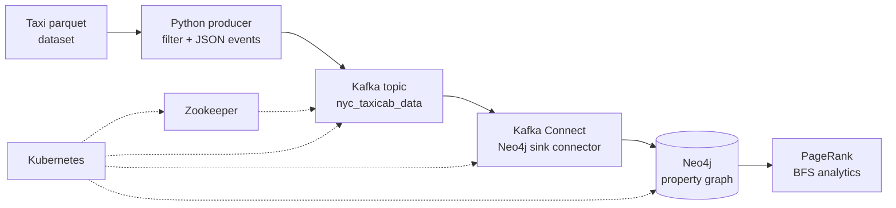

# Streaming Graph Pipeline

An end-to-end streaming data architecture: NYC taxi trip records are produced into **Apache Kafka**, streamed into **Neo4j** via **Kafka Connect**, and analyzed as a property graph (PageRank, shortest-path search) — all orchestrated on **Kubernetes**.

## Overview

Batch analytics answers "what happened." Streaming architectures answer "what is happening." This project builds the full path from raw event to queryable graph: a Python producer reads the NYC yellow-taxi parquet dataset, filters and thins it, and publishes each trip as a JSON event to a Kafka topic. A Kafka Connect sink connector consumes the topic and materializes every event as graph structure in Neo4j (`Location` nodes, `TRIP` relationships). Zookeeper, Kafka, the connector worker, and Neo4j itself all run as Kubernetes deployments, and a single script redeploys, wires, streams, and verifies the whole pipeline.

## Why This Project Matters

Most data work stops at the notebook. Production data systems are *distributed systems*: producers and consumers that never meet, schemas that evolve, services that must discover each other, and delivery semantics held together by configuration. Building this pipeline meant reasoning about ingestion → transport → storage → analytics as one system — container networking between pods, connector converter configuration, idempotent Cypher writes — rather than four separate tools. That systems-level view is the core of data engineering.

## Architecture / Workflow



**Event → graph mapping** (connector Cypher): each trip event becomes `MERGE (p:Location)-[:TRIP {distance, fare}]->(d:Location)` — pickups and dropoffs as nodes, trips as weighted edges.

## Technologies

- **Apache Kafka** (confluentinc/cp-kafka:7.3.3) + **Zookeeper** — event streaming backbone
- **Kafka Connect** (Neo4j sink connector) — stream-to-graph ingestion, JSON converters
- **Neo4j** (2025.08.0) + **Graph Data Science library** — property-graph storage and analytics
- **Kubernetes** (Minikube) + **Helm values** — orchestration, services, deployments
- **Docker** — containerized Neo4j/GDS analytics environment
- **Python** — producer (`confluent_kafka`, `pandas`, `pyarrow`) and analytics (`neo4j` driver)
- **Cypher** — graph writes and hand-rolled iterative PageRank

## Key Engineering Decisions

- **Kafka Connect instead of a custom consumer:** the sink connector with a declarative Cypher template (`neo4j.topic.cypher.*`) moves the event→graph mapping into configuration, which is exactly how production pipelines prefer it — less custom code to operate.
- **Idempotent writes (`MERGE`, not `CREATE`):** reprocessing a topic must not duplicate the graph. Every write is a `MERGE`, so the pipeline tolerates restarts and replays.
- **Two analytics implementations:** `analytics/cypher_analytics.py` implements PageRank iteratively in pure Cypher (transparent, no dependencies), while `analytics/gds_analytics.py` uses the GDS library's native `gds.pageRank` (fast, production-style). Keeping both shows the tradeoff explicitly.
- **Kubernetes-native deployment:** Zookeeper, Kafka, and the Connect worker are Deployments + Services with internal listeners (`kafka-service:29092`) separated from the external one (`localhost:9092`) — the standard pattern for talking to Kafka from inside and outside the cluster.
- **No hardcoded credentials:** every password in the original build was parameterized — scripts read `NEO4J_PASSWORD` from the environment, the Helm values ship a placeholder, and the Dockerfile takes a `--build-arg`.

## Implementation

| Path | Purpose |
|---|---|
| `producer/data_producer.py` | Reads the taxi parquet, filters to Bronx trips, publishes JSON events to Kafka (throttled) |
| `k8s/` | Zookeeper, Kafka, Kafka-Connect worker, Neo4j Service manifests; Neo4j Helm values |
| `scripts/run-pipeline.sh` | End-to-end run: redeploy → wait for readiness → register connector → stream → verify |
| `scripts/register-connector.sh` | Registers the Neo4j sink connector via the Connect REST API |
| `analytics/cypher_analytics.py` | Iterative PageRank + BFS shortest path in pure Cypher |
| `analytics/gds_analytics.py` | PageRank + BFS via the GDS library |
| `docker/` | Containerized Neo4j+GDS environment with build-time data loading (alternative to Helm) |

## Results

Running `scripts/run-pipeline.sh` against a local Minikube cluster produces a Neo4j graph where every streamed taxi trip is a `TRIP` relationship between `Location` nodes. The verification step queries the live database and reports the node count plus a sample node. `analytics/cypher_analytics.py` then ranks locations by PageRank (busiest/most central taxi zones rise to the top) and finds the shortest trip-path between two zones with BFS.

## Validation

- **Readiness gates:** the run script polls the Connect REST API until it returns HTTP 200 before registering the connector — no blind sleeps against a cold service.
- **End-to-end verification:** after streaming, a Python check queries `MATCH (n) RETURN count(n)` against Neo4j and prints a sample node, confirming events actually landed as graph structure.
- **Analytics sanity:** PageRank output is ordered by score descending and BFS returns an explicit path (or an empty list when none exists), so wrong results are visible, not silent.

## Challenges & Lessons Learned

- **Connector configuration is the real work.** Getting the Connect worker's converters (`JsonConverter`, schemas disabled), the advertised REST hostname, and the Neo4j Cypher template to agree took most of the debugging — streaming systems fail at the seams between components, not inside them.
- **Networking has two faces.** Kafka needed separate advertised listeners for in-cluster (`kafka-service:29092`) and external (`localhost:9092`) traffic; conflating them is the classic "works from here, not from there" bug.
- **Ordering matters in orchestration.** Zookeeper → Kafka → Connect worker → connector registration is a strict dependency chain; the scripts enforce it with rollout-status checks and REST polling instead of fixed sleeps wherever possible.
- **Passwords don't belong in repos.** The original build had dev passwords inline; parameterizing them via environment variables and build args was a deliberate cleanup before publishing — a habit worth keeping for anything that leaves the laptop.

## Running Locally

**Prerequisites:** Minikube (or any Kubernetes cluster), `kubectl`, Python 3 with `pip install -r requirements.txt`, and the NYC taxi parquet dataset (`yellow_tripdata_2022-03.parquet`, publicly available from the NYC TLC trip-data archive).

```bash
# 1. Start your cluster, then deploy the platform services
kubectl apply -f k8s/zookeeper-setup.yaml
kubectl apply -f k8s/kafka-setup.yaml

# 2. Deploy Neo4j via Helm using the provided values
#    (edit k8s/neo4j-values.yaml first: set your own password)
helm install neo4j-release neo4j/neo4j --values k8s/neo4j-values.yaml

# 3. Set your Neo4j password for the scripts
export NEO4J_PASSWORD="<your-password>"

# 4. Run the full pipeline (deploys connector, registers it, streams, verifies)
bash scripts/run-pipeline.sh

# 5. Run graph analytics against the streamed data
python analytics/cypher_analytics.py
```

**Alternative:** `docker/` builds a self-contained Neo4j+GDS container with the taxi data loaded at build time — useful for the analytics code without the full Kubernetes stack:

```bash
docker build --build-arg NEO4J_PASSWORD=<your-password> -f docker/Dockerfile .
```

## Repository Structure

```
streaming-graph-pipeline/
├── producer/               # Kafka producer: parquet → JSON events
├── k8s/                    # Zookeeper, Kafka, Connect worker, Neo4j manifests + Helm values
├── scripts/                # Orchestration: full run, connector registration
├── analytics/              # PageRank + BFS (pure-Cypher and GDS implementations)
├── docker/                 # Containerized Neo4j+GDS analytics environment
├── requirements.txt
├── LICENSE
└── README.md
```

## Future Improvements

- Schema Registry + Avro for the trip events instead of schemless JSON.
- Exactly-once semantics: idempotent producer + transactional sink.
- A second topic carrying a different event type to demonstrate multi-topic routing.

## Academic Context

This project was completed as part of graduate coursework in **CSE 511: Data Processing at Scale** at Arizona State University. It is presented here as academic project experience: a learning exercise in streaming and distributed systems, not a production deployment.
